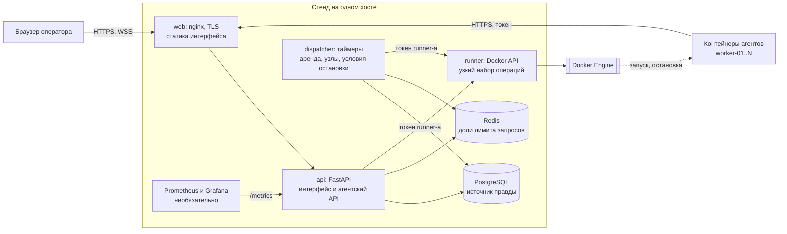
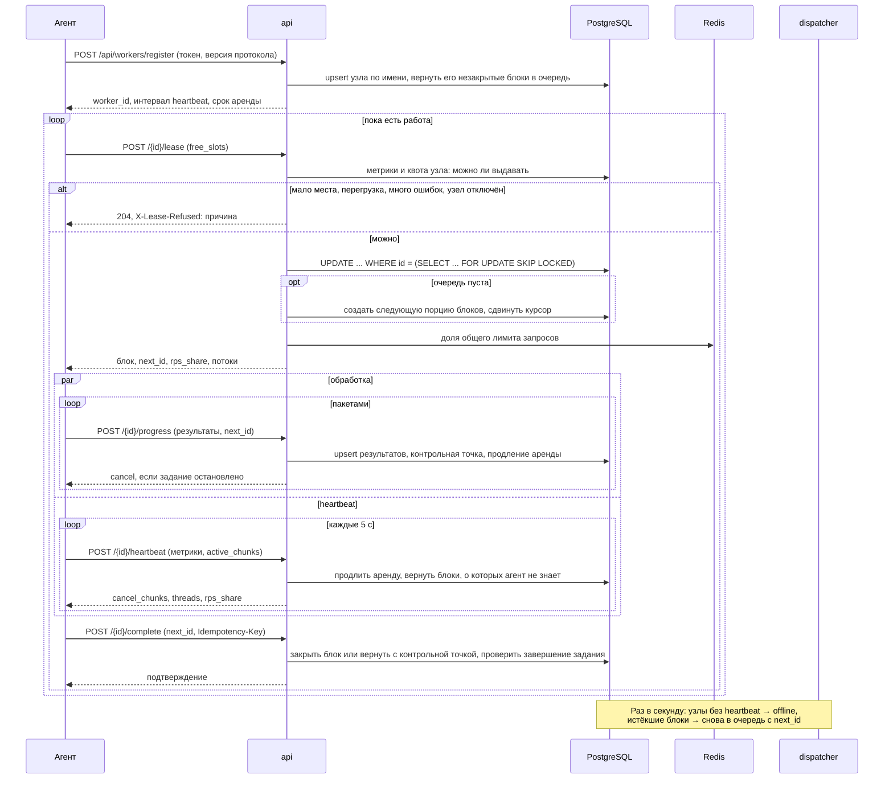
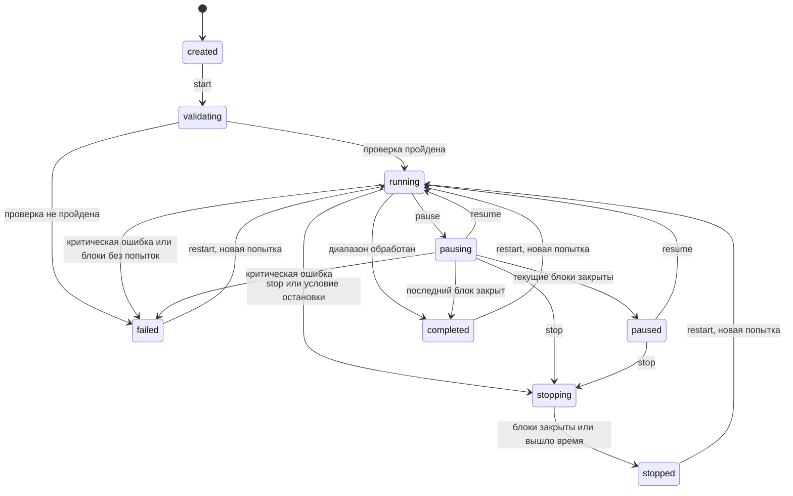

# Архитектура

Координатор управляет состоянием и раздаёт небольшие арендуемые блоки, а агенты сами выполняют
ограниченную параллельную обработку и регулярно сообщают прогресс. Источник правды один:
PostgreSQL. Поэтому `api` и `dispatcher` можно убить в любой момент, ничего не потеряв.

## Компоненты

| Компонент | За что отвечает | Что ему можно |
|---|---|---|
| `web` | TLS, статика, прокси `/api/`, заголовки безопасности | Единственный открытый наружу порт |
| `api` | Интерфейс, агентский API, выдача блоков | База, Redis, HTTP к runner. Сокета Docker нет |
| `dispatcher` | Истечение аренды, недоступные узлы, условия остановки, доли лимита, снимки скорости | Те же |
| `runner` | Создать, запустить, остановить, обновить образ, журнал, `docker exec` | Сокет Docker, но только контейнеры с меткой `lab.worker` и образы из allowlist |
| Заглушка, агент | Проверка идентификаторов, загрузка файлов | Только HTTP API |

Выдача блока идёт через `api`, а не через диспетчер: она атомарна на уровне базы
(`SELECT ... FOR UPDATE SKIP LOCKED`), и лишний посредник ничего не добавил бы. Поэтому падение
диспетчера не останавливает работу: откладываются только таймеры.

## Выдача блока

Почему так:

- **Блоки создаются по мере работы.** В `jobs.next_chunk_start` хранится курсор. Огромный и открытый
  диапазоны устроены одинаково, задание на 10¹⁵ идентификаторов создаётся мгновенно.
- **`complete` с неполным `next_id`** возвращает блок в очередь с контрольной точкой: так агент
  отдаёт работу при остановке, и следующий узел не повторяет сделанное.
- **Поздний ответ принимается,** если блок никому не передан: результаты идемпотентны, а сбой мог быть
  на стороне координатора. Если передан, агент получает 409.
- **Heartbeat сверяет блоки с `active_chunks`.** Иначе блок, потерянный агентом из-за сбоя, продлевался
  бы вечно, пока узел жив.
- **Блокировка задания при закрытии блока.** Без неё два параллельных закрытия последних блоков
  не видят друг друга, и задание остаётся в работе навсегда. На это есть тест.

## Состояния задания

Таблица переходов лежит в `domain/statuses.py`. Всё, чего в ней нет, отклоняется с кодом 409.

Мягкая пауза запрещает выдачу новых блоков, но текущие дорабатываются. Немедленная остановка просит
агентов прекратить блоки через ответы `heartbeat` и `progress`. Кто не отреагировал за 10 секунд,
теряет аренду. Контрольные точки сохраняются в обоих случаях.

## Гарантии

| Гарантия | Как обеспечена |
|---|---|
| Один блок не выдаётся двум агентам | `FOR UPDATE SKIP LOCKED`; повторная выдача только после возврата в очередь |
| Обработка at least once без дубликатов | Уникальные ключи и upsert; `Idempotency-Key` с номером попытки блока |
| Загруженный файл не теряется при повторной проверке | Статус `completed` не понижается поздним результатом |
| Отказ узла не теряет работу | Контрольная точка `next_id`; блок снимается не позже двух интервалов heartbeat |
| Перезапуск координатора не теряет подтверждённого | Состояние только в базе; после простоя узлы получают один срок на восстановление |
| База недоступна: запрос не подтверждается ложно | 503 с `Retry-After`, агент повторяет |
| Файл только внутри каталога хранения | Путь проверяется, а не исполняется: координатор диска агента не видит |

## Лимит запросов

Все контейнеры выходят в сеть через один IP, поэтому лимит общий. Диспетчер раз в секунду делит его
между узлами пропорционально потокам с поправкой на лимит CPU: `effective_threads`. Ответы 429 и 5xx
из результатов агентов снижают общий лимит вдвое, без них он возвращается на 5 % за проход.
Доли хранятся в Redis и отдаются в `lease` и `heartbeat`. Без Redis узлы получают равные доли,
посчитанные по базе, и работа не останавливается.

## Безопасность

| Требование | Реализация |
|---|---|
| Аутентификация, роли | Сессии в базе, в cookie только токен, в базе его хэш; пароли через scrypt; роли viewer, operator, administrator на каждом маршруте |
| CSRF | Заголовок `X-CSRF-Token` на всех изменяющих запросах плюс `SameSite=Strict` |
| XSS | React экранирует вывод; CSP запрещает встроенные и чужие скрипты |
| TLS | Интерфейс и агенты ходят через nginx; HTTP только перенаправляет |
| Идентичность агента | Отдельный токен на узел, в базе хэш, ротация без остановки |
| Секреты | Файлы `secrets/` вне git, в контейнер как docker secrets, не в окружении |
| Журналы | Маскирование паролей, токенов, cookie и строк подключения при записи |
| Аудит | Таблица только на добавление: изменение и удаление запрещены триггером в базе |
| Docker API | Только runner: allowlist образов и окружения, только свои контейнеры |
| Терминал | Только администратор, проверка Origin, журнал команд, политика опасных команд, автозавершение |
| Экспорт CSV | Формулы нейтрализуются: названия приходят с внешнего сайта |

Роли на маршрутах проверяет тест `test_every_api_route_is_protected`: он обходит всю схему OpenAPI,
поэтому новый маршрут без проверки прав не пройдёт незамеченным.
