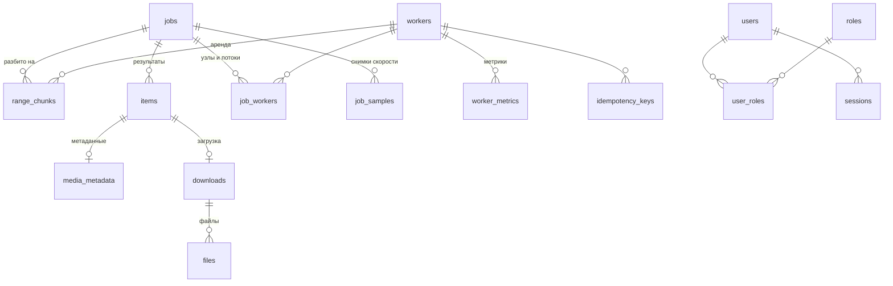

# Схема базы данных

PostgreSQL 17, миграции Alembic в `migrations/versions`. Все метки времени `timestamptz`, в UTC.

## Таблицы

| Таблица | Назначение | Важные ограничения |
|---|---|---|
| `jobs` | Задания: диапазон, параметры, статус, курсор `next_chunk_start` | Индекс по `status`; `range_to` пустой у открытого диапазона |
| `job_workers` | Узлы задания и индивидуальные потоки. Нет строк — задание для всех | Первичный ключ (`job_id`, `worker_id`) |
| `job_samples` | Снимки прогресса раз в 3 с, из них считаются скорость и оставшееся время | Индекс (`job_id`, `at`); хранятся 4 часа |
| `range_chunks` | Блоки диапазона, контрольная точка `next_id`, аренда, попытки | Уникально (`job_id`, `range_start`, `range_end`, `retry_round`); индекс (`job_id`, `status`) |
| `items` | Результат по идентификатору | Уникально (`job_id`, `external_id`); индекс (`job_id`, `status`) |
| `media_metadata` | Название, адреса, размер, MIME, контрольная сумма | Один к одному с `items` |
| `downloads` | Загрузка элемента | Уникально `item_id` |
| `files` | Файл на узле | Уникально (`download_id`, `storage_path`) |
| `idempotency_keys` | Применённые ключи `complete` и `fail` вместе с номером попытки блока | Первичный ключ (`worker_id`, `key`); хранятся 24 часа |
| `workers` | Узлы: контейнер, лимиты, настройки оператора, снимок метрик, поля режима ssh | Уникально `name`; индекс `last_heartbeat_at` |
| `worker_metrics` | Временной ряд метрик и счётчиков | Индекс (`worker_id`, `collected_at`); хранятся 24 часа |
| `agent_tokens` | Токены агентов, только хэш, срок и отзыв | Уникально `token_hash` |
| `users`, `roles`, `user_roles` | Пользователи и роли | Уникально `login`, `roles.name` |
| `sessions` | Сессии: хэш токена, CSRF-токен, срок | Индекс `expires_at` |
| `events` | Журнал событий с полями из ТЗ, п. 15 | Индексы (`job_id`, `at`), (`worker_id`, `at`), `at`; хранятся 30 дней |
| `audit_log` | Журнал аудита | Изменение и удаление запрещены триггером |

## Заметки

- `range_chunks.retry_round`: 0 — основной проход, больше нуля — блоки повтора ошибок. Они лежат внутри
  уже обработанного диапазона, поэтому прогресс задания считается только по нулевому проходу.
- `range_chunks.leased_by` после возврата блока в очередь сохраняет последнего владельца: поздний
  `complete` от него будет принят, если блок никому не передан.
- `workers.provisioning_mode`: `ssh` или `docker`. Для `ssh` заполнены поля `ssh_*`, причём в
  `ssh_key_ref` хранится имя секрета, а не сам ключ. `agent_kind` — что ставить на сервер (`real` или
  `stub`), `desired_agent_state` — в каком состоянии должен быть агент (`running` или `stopped`).
- `workers.container_state` для `ssh`-узла: `state` (`running`, `stopped`, `starting`, `not_installed`,
  `unreachable`), `ssh`, `python`, `kernel`, `restart_count`, `error`, в `image` — выпуск агента, в `id` — pid.

## Миграции

Применяются отдельным сервисом `migrate` при каждом `docker compose up`, в том же запуске создаются
начальный администратор и токены узлов. CI прогоняет миграции на чистой базе и проверяет откат.
