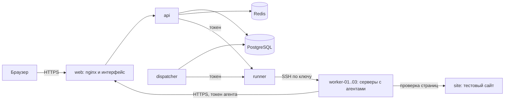

# Ushastiy

Лабораторная работа «Распределённая система обнаружения и загрузки видеоматериалов». Координатор делит
диапазон идентификаторов на небольшие блоки и раздаёт их агентам на рабочих серверах. Агенты проверяют
идентификаторы на сайте, сохраняют метаданные и скачивают файлы. Оператор следит за всем в веб-интерфейсе.

Арендовать серверы и подключаться к внешнему сайту не нужно. Контейнеры изображают отдельные машины с SSH:
координатор сам входит на них по ключу, ставит агента и запускает его. Страницы отдаёт управляемый
тестовый сайт, в том числе с ответами 403, 429 и 500.



## Что в репозитории

| Путь | Что это |
|---|---|
| [`App/`](App/README.md) | Платформа: координатор, API, интерфейс, runner, мониторинг, сценарии проверки. Стенд запускается отсюда |
| [`Agent/`](Agent/README.md) | Настоящий агент рабочего узла, только стандартная библиотека Python |
| `.github/workflows/` | CI платформы |
| `ЛАБОРАТОРНАЯ_РАБОТА_1.docx` | Техническое задание |
| `ПЛАН_1_Агент.docx`, `ПЛАН_2_Платформа.docx` | Планы реализации |
| `build_plans.py`, `docbuilder.py` | Сборка планов в `.docx`. Для запуска стенда не нужны |

## Запуск на новом устройстве

Достаточно клона репозитория. Пароль, токены, ключ SSH и сертификаты создаются на месте, база пустая. Со
старого устройства ничего переносить не нужно.

Эти шаги проверены на Windows 11 с Docker Desktop и на чистом Linux с Docker 29. На macOS запуск не проверялся.

### 1. Что установить

| Система | Docker | Остальное |
|---|---|---|
| Windows | [Docker Desktop](https://www.docker.com/products/docker-desktop/) | [Git for Windows](https://git-scm.com/download/win). Все команды выполняйте в **Git Bash**: в нём уже есть `bash`, `openssl` и `ssh-keygen` |
| Linux | [Docker Engine](https://docs.docker.com/engine/install/) и плагин Compose | `git`, `openssl`, `openssh-client` |
| macOS | [Docker Desktop](https://www.docker.com/products/docker-desktop/) | `git`, остальное уже есть в системе |

Нужно примерно 4 CPU, 8 ГБ памяти и 10 ГБ на диске. На Docker Desktop эти ресурсы задаются в его настройках.
Порты 8443 и 8080 должны быть свободны, другие можно задать, см. [настройки](#настройки).

Docker должен быть запущен, а версия Compose — не ниже 2.24.4:

```bash
docker compose version
```

### 2. Скачать и запустить

```bash
git clone https://github.com/Andraboba/Ushastiy.git
```

```bash
cd Ushastiy/App
```

```bash
bash scripts/init-env.sh
```

```bash
docker compose up -d --build
```

При первом запуске скачиваются базовые образы и зависимости, примерно 2 ГБ. На быстрой сети это занимает
около минуты, на медленной дольше. Следующие запуски идут намного быстрее.

### 3. Убедиться, что всё работает

```bash
docker compose ps
```

У `db`, `redis`, `api`, `web` и `worker-01..03` должно быть `healthy`, у `dispatcher`, `runner` и `site` —
`running`. Откройте **https://localhost:8443**. Браузер предупредит о сертификате, потому что он подписан
собственным центром стенда: подтвердите исключение или добавьте в доверенные `App/deploy/tls/ca.crt`.

Логин `admin`, пароль покажет команда:

```bash
cat secrets/coord_admin_password
```

На странице «Узлы» три сервера перейдут в состояние «В сети» в течение нескольких секунд после запуска. В
«Журнале» будут события `agent.deploy`: агентов поставил сам координатор.

### 4. Первое задание

«Задания» → диапазон `[100,1299]`, размер блока `100` → «Создать» → «Запустить». Прогресс виден на «Панели»
и на странице задания. Часть идентификаторов закончится ошибками или будет не найдена: тестовый сайт отвечает
так специально.

Проверка отказа: остановите сервер, блок вернётся в очередь. После запуска координатор сам поднимет агента.

```bash
docker compose stop worker-02
```

```bash
docker compose start worker-02
```

Полный сценарий показа по шагам описан в [App/docs/demo.md](App/docs/demo.md).

## Управление стендом

Команды выполняются из каталога `App`.

Запустить снова после остановки или перезагрузки. Данные сохраняются:

```bash
docker compose up -d
```

Посмотреть журналы:

```bash
docker compose logs -f runner dispatcher
```

Обновить после `git pull`. Миграции базы применятся сами:

```bash
docker compose up -d --build
```

Остановить. Данные сохраняются:

```bash
docker compose down
```

**Удалить всё, включая базу и скачанные файлы.** Отменить это нельзя:

```bash
docker compose down -v
```

Контейнеры, созданные кнопкой «Добавить сервер», не входят в проект compose. Как их удалить, описано в
[App/docs/operations.md](App/docs/operations.md).

## Что не хранится в git

| Что | Откуда берётся |
|---|---|
| `App/secrets/`: пароль администратора, токены, ключ SSH | `init-env.sh`, на каждом устройстве свои |
| `App/deploy/tls/`: центр сертификации и сертификат сервера | `init-env.sh` |
| `App/.env`: локальные настройки | `init-env.sh` копирует `.env.example` |
| База, файлы агентов, запомненные ключи серверов | Тома Docker, создаются при запуске |

Задания и результаты между устройствами сами не переносятся: новый стенд начинает с пустой базы.

## Настройки

Задаются в `App/.env`, применяются командой `docker compose up -d`. Полный список находится в
`App/src/coordinator/config.py`.

| Переменная | По умолчанию | Смысл |
|---|---|---|
| `COORD_HTTPS_PORT` | 8443 | Порт интерфейса. С другим значением открывайте сразу `https://localhost:<порт>`: перенаправление с HTTP всегда ведёт на 8443 |
| `COORD_HTTP_PORT` | 8080 | Порт перенаправления на HTTPS |
| `COORD_AGENT_KIND` | `real` | Что ставить на новые серверы: `real` — настоящий агент, `stub` — заглушка для имитации отказов |
| `COORD_GLOBAL_RPS_LIMIT` | 3000 на стенде | Общий лимит запросов. **Перед работой с настоящим сайтом обязательно снизьте** |
| `COORD_API_WORKERS`, `COORD_API_CPUS` | 1, 1.0 | Процессы `api` и лимит CPU для них, нужны примерно от 30 агентов |

## Другие режимы

**Мониторинг.** Prometheus и Grafana доступны только с этой машины. Grafana: http://localhost:3000, логин
`admin`, пароль тот же.

```bash
docker compose --profile monitoring up -d
```

**Заглушки вместо настоящих агентов.** Нужны для сценариев отказов. На стенде с данными вид агента меняется
кнопкой на странице узла, а новые серверы получают значение из настройки.

```bash
COORD_AGENT_KIND=stub docker compose up -d --build
```

**Без TLS, для разработки.** Интерфейс: http://localhost:8080, API: http://localhost:8000.

```bash
docker compose -f compose.yaml -f deploy/compose.dev.yaml up -d --build
```

**Агент как контейнер, без SSH.** Прежний режим: перезапуск по restart policy, управление через Docker API.

```bash
docker compose -f compose.yaml -f deploy/compose.docker-mode.yaml up -d --build
```

Режимы нельзя просто переключать поверх стенда с данными: уже заведённые серверы останутся в прежнем режиме.
Перед сменой режима удалите данные командой `docker compose down -v`.

**Настоящая машина вместо контейнера.** Заведите на ней пользователя без прав root, положите ему открытый ключ
`App/secrets/ssh_client_key_pub`, разрешите адрес в `COORD_SSH_ALLOWED_HOSTS` и добавьте сервер в интерфейсе.
Подробности в [App/docs/operations.md](App/docs/operations.md). На арендованной машине этот режим пока не
проверялся.

## Проверки

Полная проверка платформы, как в CI: линтеры, миграции на чистой базе, все тесты. Успех — строка `CI OK`.
Запускается из каталога `App`:

```bash
bash scripts/ci.sh
```

Чек-лист приёмки на поднятом стенде, нужен Python 3. На Windows вместо `python3` пишите `python`:

```bash
python3 scripts/acceptance.py
```

Двенадцать сценариев отказов. Стенд должен быть запущен с заглушками:

```bash
python3 scripts/chaos.py
```

Нагрузочный тест, описание результатов в [App/docs/load-report.md](App/docs/load-report.md):

```bash
bash scripts/loadtest.sh
```

Тесты агента и демонстрация без сайта и координатора. Запускаются из каталога `Agent`, нужен Python 3.10+:

```bash
python3 -m unittest discover -s tests -t .
```

```bash
python3 tools/demo.py
```

## Если что-то не работает

| Что видно | Причина и решение |
|---|---|
| `failed to connect to the docker API`, `Cannot connect to the Docker daemon` | Docker не запущен. Запустите Docker Desktop или службу `docker` и повторите команду |
| `ssh-keygen: command not found`, `openssl: command not found` | На Windows запускайте из Git Bash, на Linux установите `openssh-client` и `openssl` |
| `$'\r': command not found`, `bad interpreter` | Файлы получили окончания строк Windows. Удалите клон и склонируйте заново: `.gitattributes` закрепляет LF |
| `port is already allocated`, `ports are not available` | Порт занят другой программой. Задайте `COORD_HTTPS_PORT` и `COORD_HTTP_PORT` в `App/.env` |
| `!override` или `unknown tag` при запуске | Compose старше 2.24.4. Обновите Docker |
| Браузер предупреждает о сертификате | Так и должно быть на стенде, см. шаг 3 |
| Пароль из файла не подходит | Администратор создаётся при первом запуске, а база хранит прежние данные. Либо верните прежний файл, либо удалите данные командой `docker compose down -v` |
| Узлы долго не переходят в «В сети» | Откройте страницу узла и нажмите «Проверить». Причину покажет `docker compose logs runner dispatcher` |
| На странице узла `host_key_changed` | Ключ сервера изменился. Если сервер действительно пересоздан начисто, нажмите «Сервер заменён: забыть его ключ» |
| Контейнеры завершаются с кодом 137, сборка падает без причины | Не хватает памяти. На Docker Desktop выделите 8 ГБ в настройках |

## Документация

- [Платформа: структура кода и команды](App/README.md)
- [Агент: состав, конфигурация, настройка под сайт](Agent/README.md)
- [Архитектура и диаграммы](App/docs/architecture.md)
- [Схема базы данных](App/docs/database.md)
- [Описание API в формате OpenAPI](App/docs/openapi.json)
- [Установка, обновление, масштабирование, серверы и ключи SSH](App/docs/operations.md)
- [Руководство оператора](App/docs/operator-guide.md)
- [Сценарий демонстрации](App/docs/demo.md)
- [Отчёт о нагрузочном тестировании](App/docs/load-report.md)
- [Ограничения и известные проблемы](App/docs/limitations.md)
- [План работ и принятые решения](App/PLAN.md)

Планы в `.docx` пересобираются из корня репозитория, нужен пакет `python-docx`:

```bash
python3 build_plans.py
```
